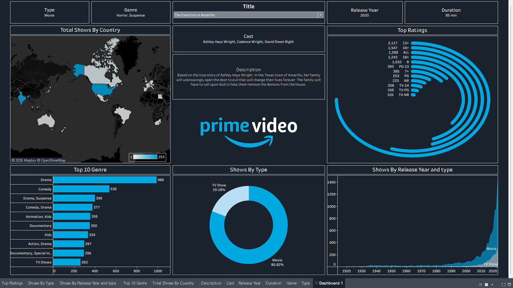

# 📊 Amazon Prime Video Content Analysis Dashboard

## 📌 Project Overview

This project is my first Tableau dashboard, created to explore and analyze the content available on Amazon Prime Video. The dashboard presents key insights about movies and TV shows through interactive visualizations and a clean, dark-themed design.

The goal of this project is to practice data visualization, explore content distribution, and present data in an easy-to-understand format.

## 🎯 Project Objectives

- Analyze the distribution of Movies and TV Shows.
- Explore the most popular genres by title count.
- Visualize content distribution across countries.
- Understand content trends by release year.
- Analyze the distribution of content ratings.
- Display detailed information about selected titles.

## 📈 Dashboard Features

- **Country Analysis:** A geographical map showing content distribution by country.
- **Top 10 Genres:** A bar chart comparing genres based on the number of titles.
- **Movies vs TV Shows:** A donut chart showing the distribution of content types.
- **Release Year Analysis:** A visualization showing content trends over time by type.
- **Ratings Analysis:** A chart displaying the distribution of content ratings.
- **Title Details:** Information about selected titles, including cast, genre, release year, duration, and description.
- **Interactive Filters:** Options to explore the dashboard and view relevant title information.

## 🛠️ Tools & Technologies

- **Tableau** — Dashboard development and data visualization.
- **Data Analysis** — Exploring and interpreting content data.
- **Git & GitHub** — Version control and project sharing.

## 🖼️ Dashboard Preview

## 📂 Project Files

| File | Description |
|---|---|
| `Prime_Video_Dashboard.twbx` | Packaged Tableau workbook |
| `dashboard-screenshot.png` | Dashboard preview image |
| `README.md` | Project documentation |

*Note: Update the workbook filename in this table if your actual filename is different.*

## 💡 Key Learnings

Through this project, I gained practical experience in:

- Creating different types of charts in Tableau.
- Combining multiple worksheets into a single dashboard.
- Working with filters and dashboard interactions.
- Designing a dashboard with consistent colors and layout.
- Presenting data insights through visualizations.

## 🚀 Future Improvements

- Add KPI cards for key metrics.
- Improve dashboard interactivity and usability.
- Explore additional insights from the dataset.
- Refine chart formatting and dashboard layout.

## 👨‍💻 About the Project

This is my first Tableau dashboard project and an important step in my data analytics learning journey. I look forward to building more projects and improving my skills in Tableau and data visualization.

---

⭐ **Thank you for visiting my project!**